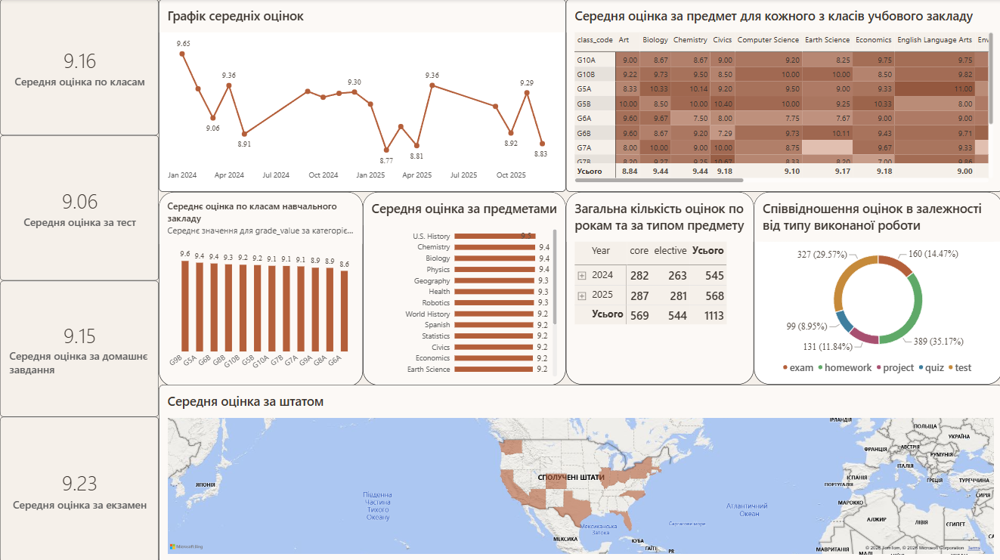
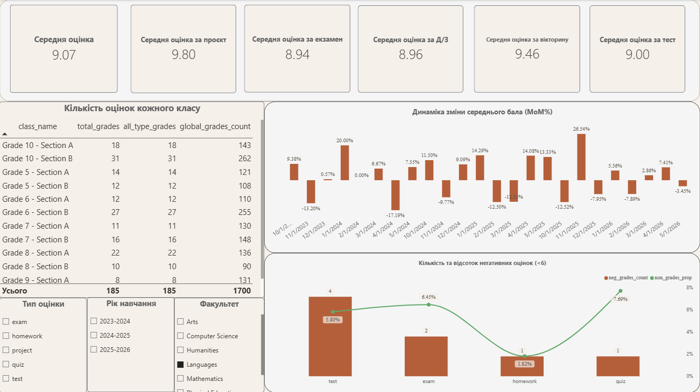
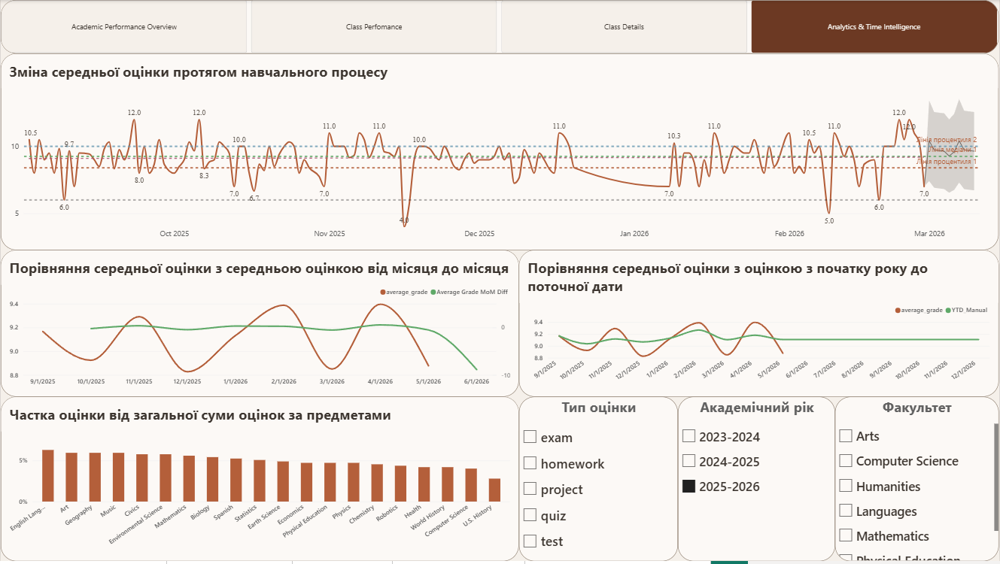

# Аналіз успішності учнів — дашборд у Power BI

Інтерактивний дашборд для аналізу академічної успішності учнів навчального закладу: середні оцінки за класами, предметами та типами робіт, пошук періодів спаду, частка негативних оцінок і прогноз зміни середнього бала.

## Мета проєкту

- Проаналізувати успішність учнів у розрізі **класів, предметів і типів робіт** (екзамен, тест, домашнє завдання, проєкт, вікторина).
- **Виявити періоди спаду** успішності та проаналізувати їх динаміку від місяця до місяця.
- Знайти **слабкі місця**: класи й предмети з нижчим середнім балом, типи робіт з найбільшою часткою негативних оцінок.
- **Спрогнозувати тенденцію** зміни середньої оцінки статистичними методами.

## Дані

Усі дані отримано з **відкритих джерел**. Модель побудована за схемою «зірка»:

| Таблиця | Зміст |
|---|---|
| `grades` | Таблиця фактів: оцінка (`grade_value`), тип роботи (`grade_type`), дата |
| `students` | Учні, у тому числі штат (`state`) |
| `classes` | Класи та паралелі (`class_code`, `class_name`) |
| `subjects` | Предмети, тип предмета (обов'язковий / вибірковий), факультет |
| `periods` | Навчальні роки (2023–2024, 2024–2025, 2025–2026) |
| `calendar` | Таблиця дат для аналізу часових рядів |
| `_Measures` | Окрема таблиця для всіх DAX-мір |

## Використані методи

**Аналіз часових рядів (DAX, Time Intelligence)**
- Зміна середнього бала від місяця до місяця у відсотках (**MoM %**) та в абсолютних значеннях.
- Порівняння з попереднім періодом (`previous_grade`).
- Накопичене середнє з початку року (**YTD**).

**Вбудовані аналітичні інструменти Power BI**
- Лінії **25-го та 75-го процентилів** і **медіани**: показують нормальний діапазон середнього бала.
- **Лінія тенденції** для оцінки загального напрямку змін.
- Константна лінія на рівні **6 балів**: межа негативної оцінки.
- **Прогноз** середньої оцінки на 10 періодів уперед з **довірчим інтервалом 95 %**.

**Продуктивність обчислень**
- Усі розрахунки винесено в окрему таблицю мір `_Measures`; модель «зірка» з окремою таблицею дат.

**Корпоративний стандарт звітності**
- Єдина колірна тема, однакова структура сторінок, KPI-картки у верхній частині, фільтри (тип оцінки, навчальний рік, факультет) на кожній аналітичній сторінці.
- Навігація між сторінками, сторінка деталізації (drillthrough) і сторінка-підказка (tooltip).

## Структура дашборду

### 1. Academic Performance Overview — загальний огляд



- KPI-картки: середня оцінка загалом і за типами робіт.
- Динаміка середньої оцінки за місяцями.
- Матриця «клас × предмет» з колірним кодуванням середнього бала.
- Рейтинг класів і предметів за середньою оцінкою.
- Кількість оцінок за роками та типом предмета (обов'язковий / вибірковий).
- Розподіл оцінок за типом роботи.
- Карта середньої оцінки за штатами.

### 2. Class Performance — успішність класів



- KPI-картки за кожним типом роботи.
- Таблиця кількості оцінок за класами.
- **Динаміка зміни середнього бала (MoM %)**: показує місяці спаду та зростання.
- **Кількість і частка негативних оцінок (< 6)** за типами робіт.
- Фільтри: тип оцінки, навчальний рік, факультет.

### 3. Analytics & Time Intelligence — аналітика та прогноз



- Щоденна динаміка середньої оцінки з лініями процентилів, медіани, тенденції та **прогнозом**.
- Порівняння середньої оцінки зі зміною від місяця до місяця.
- Порівняння середньої оцінки з накопиченим середнім з початку року (YTD).
- Частка оцінок за предметами.

### 4. Додаткові сторінки

- **Class Details** — сторінка деталізації (drillthrough): показники кожного учня класу за всіма типами робіт.
- **MoM%_AG_Details** — підказка (tooltip): середня оцінка, оцінка за попередній місяць і зміна у відсотках.

## Ключові висновки

*Значення наведено зі скріншотів; на сторінках 2 і 3 вони залежать від вибраних фільтрів.*

- **Загальний рівень високий:** середня оцінка за класами — **9,16**; за екзамени — **9,23**, за домашні завдання — **9,15**, за тести — **9,06**.
- **Розрив між класами — 1 бал:** найвищий середній бал у класу **G9B (9,6)**, найнижчий — у **G6A (8,6)**. Клас G6A — перший кандидат для додаткової уваги.
- **Періоди спаду:** найнижчі місячні значення — **січень 2025 (8,77)**, **квітень 2025 (8,81)** та **грудень 2025 (8,83)**. Спади припадають на зимові та весняні місяці; варто перевірити їх зв'язок із сесіями та канікулами.
- **Найбільші коливання (фільтр «Languages»):** падіння на **−17,19 %** у квітні 2024 р. та зростання на **+26,54 %** у листопаді 2025 р.
- **Негативні оцінки (фільтр «Languages»):** найбільша частка — у вікторинах (**7,69 %**) та екзаменах (**6,45 %**), найменша — у домашніх завданнях (**1,82 %**).
- **Структура оцінювання:** найбільше оцінок — за домашні завдання (**35,17 %**) і тести (**29,57 %**), найменше — за вікторини (**8,95 %**).

## DAX-міри

| Міра | Що показує |
|---|---|
| `average_grade` | Середня оцінка |
| `average_grade_exam`, `_test`, `_homework`, `_project`, `_quiz` | Середня оцінка за типом роботи |
| `total_grades`, `all_type_grades`, `global_grades_count` | Кількість оцінок у різних контекстах фільтрів |
| `previous_grade` | Середня оцінка за попередній місяць |
| `MoM_AG%` | Зміна середньої оцінки від місяця до місяця, % |
| `Average Grade MoM Diff` | Зміна середньої оцінки від місяця до місяця, бали |
| `YTD_Manual` | Накопичене середнє з початку року |
| `neg_grades_count` | Кількість негативних оцінок (< 6) |
| `non_grades_prop` | Частка негативних оцінок від загальної кількості |

## Як відкрити

1. Завантажте файл [`dashboard/academic_performance_dashboard.pbix`](dashboard/academic_performance_dashboard.pbix).
2. Відкрийте його в [Power BI Desktop](https://www.microsoft.com/power-platform/products/power-bi/desktop) (безкоштовно, Windows).
3. Перемикайте сторінки кнопками навігації вгорі; для деталізації класу клацніть правою кнопкою на класі → **Drill through → Class Details**.

## Структура репозиторію

```
├── README.md
├── dashboard/
│   └── academic_performance_dashboard.pbix
└── images/
    ├── 01-academic-performance-overview.png
    ├── 02-class-performance.png
    └── 03-analytics-time-intelligence.png
```

## Інструменти

Power BI Desktop · DAX · Power Query · Time Intelligence · вбудована аналітика Power BI (процентилі, медіана, тренд, прогноз)

## Автор

**Vladyslav Matviiuk** — студент напряму «Фінанси та облік у бізнесі», Ченстоховський політехнічний університет.
[Kaggle](https://www.kaggle.com/vladyslavmatviiuk)
